# pwm8-spi: 8-channel PWM controller with SPI on SCL 1.2 um C1D (Silicon No. OS0097)

An 8-channel, 8-bit PWM controller with an SPI register interface, taped out on SCL's 1.2 um C1D open PDK in the
standard 5 mm x 5 mm pad frame (52-pin DIP chip-on-board). Built with an open-source RTL-to-GDSII flow:
Yosys, OpenROAD (OpenLane 1.0.2 container), OpenSTA, Icarus Verilog, Verilator and KLayout.

- **Function:** 16-bit SPI mode 0 frames (MSB first) write eight 8-bit duty registers, a prescaler and a control
  register, and read back any register plus a read-only ID (`0xA5`). PWM frequency
  `f_pwm = f_clk / (256 x (PRESC + 1))`. `sync` pulses once per PWM period. Full register map in `docs/spec.md`.
- **Clocks:** `clk` (registers + PWM) 10 MHz, `sclk` up to 2.5 MHz, fully asynchronous; toggle-synchronised CDC
  and a two-flop reset synchroniser.
- **Pins:** inputs on IPAD00 (PAD2 clk, PAD4 rst_n, PAD6 sclk, PAD8 cs_n, PAD10 mosi); outputs on OPAD04
  (PAD1 miso, PAD3 sync, PAD13-PAD21 / PAD25-PAD29 pwm_out[7:0]). Full pad map in `rtl/chip/pwm8_spi_chip.v`.
- **Timing:** signed off at min/typ/max, TNS 0; worst setup slack +73.2 ns, hold +0.83 ns.
- **Verification:** RTL testbenches (`tb_pwm_core` 30/30, `tb_pwm8_spi_top` 54/54, chip-level 55 checks),
  gate-level and post-layout SDF simulation pass at all corners; Verilator `-Wall` clean; LVS match;
  DRC 0 violations (72 rules) with `c1d_drc.drc` v1.1.

## Size and process

| | |
|---|---|
| Die | 5 mm x 5 mm = 25 mm² |
| Core (routed block) | 3.6 mm x 3.6 mm = 12.96 mm² |
| Standard-cell area | 3.04 mm² (1,330 cells, 211 flip-flops; about 23 % of the core) |
| Transistors | about 19,600 (cell count x transistors per cell from SCL's cell netlists) |
| Density | about 6,400 transistors / mm² of cell area, about 780 / mm² of die |
| Clock | 10 MHz (`clk`), SPI up to 2.5 MHz |

**What "1.2 um" means here.** On SCL C1D the name is a real dimension: the minimum drawn gate length of an NMOS
transistor is 1.2 um (PMOS 1.5 um). Other minimum rules from SCL's DRC deck (`c1d_drc.drc` v1.1): poly width
1.2 um, diffusion width 2.5 um, metal1 2.4 um wide / 1.5 um spacing, metal2 2.5 um wide / 1.7 um spacing. It is a
planar n-well CMOS process with two metal layers. One flip-flop (`DFCL11`) is 100.8 um x 48.7 um.

**Compared with a "2 nm" chip.** Modern node names are generation labels, not measurements: nothing on a "2 nm"
chip is 2 nm wide. A 2 nm-class process has gate lengths of roughly 12-16 nm, metal pitches of roughly 20-25 nm,
gate-all-around nanosheet transistors, 15+ metal layers and roughly 200-300 million transistors per mm², about
40,000 times this chip's density. Up to the 1990s node names did match the gate length, as 1.2 um does here
(the Intel 80386 of 1985 used a similar 1.5 um process).

## Images

Rendered from the final submitted GDS with KLayout. Every image is regenerated by `flow/make_images.sh
flow/images_pwm8.sh`; `images/README.md` explains each folder.

| | |
|---|---|
| 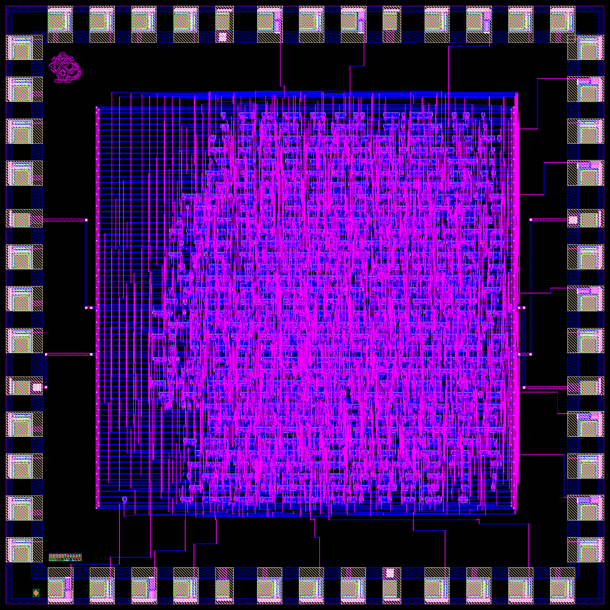 | 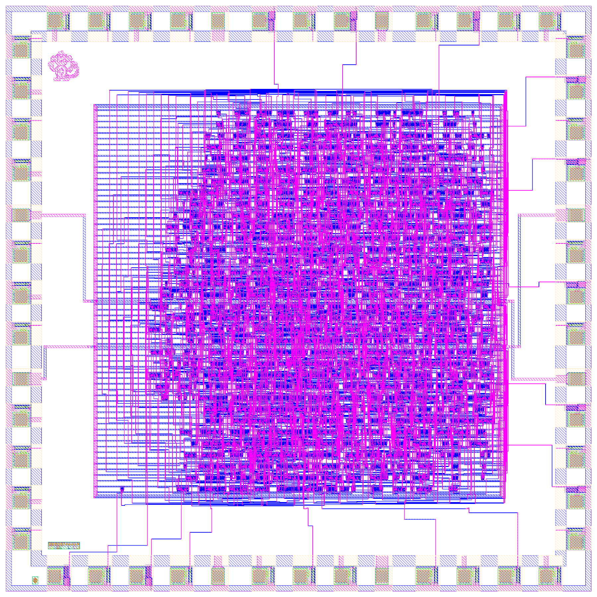 |
| **The whole 5 mm x 5 mm die:** pad ring, channel wiring, the routed core, the chip art and the Silicon No. block | Same view on a light background |
| 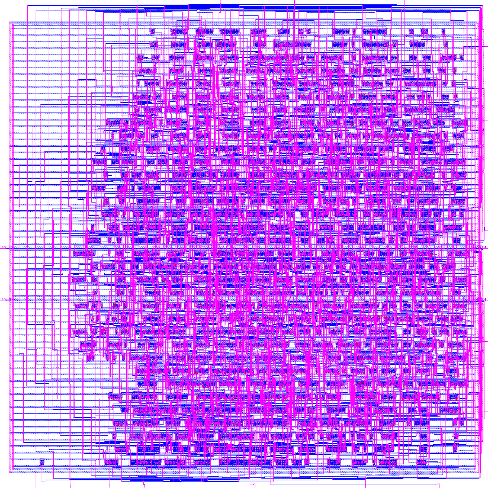 | 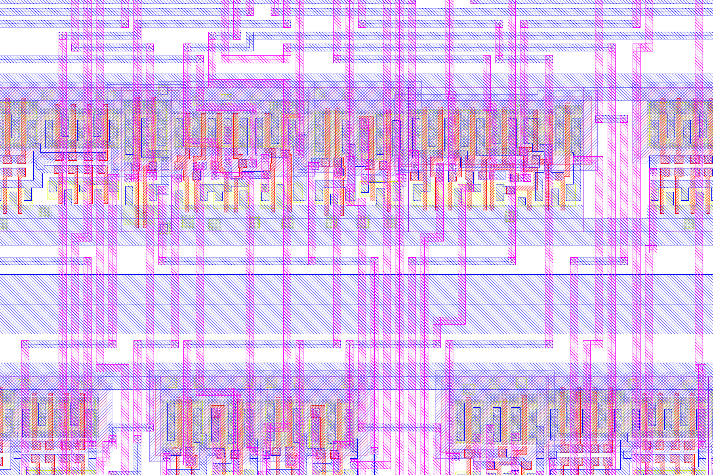 |
| **The routed core:** standard-cell rows, power ring, metal1/metal2 routing | **Close-up of the core:** individual cells, rails and wires |
| 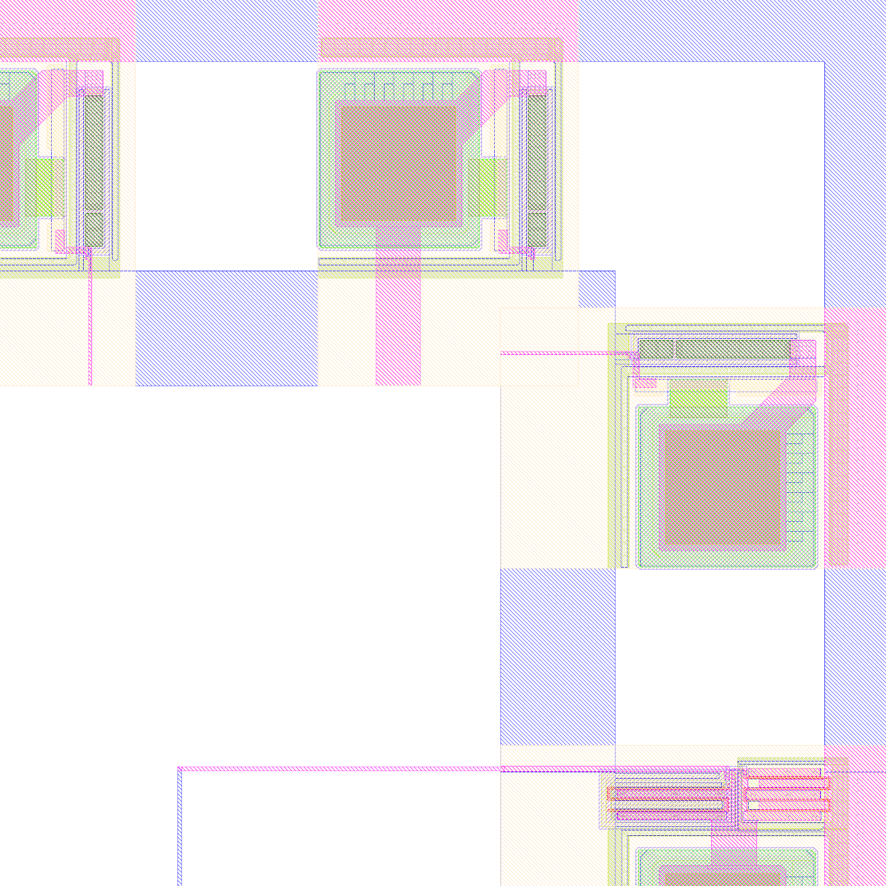 | 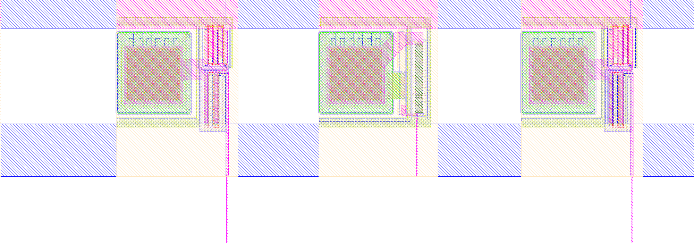 |
| **Pad ring corner:** bond pads with their driver/ESD structures | **Pads along an edge,** wired into the core |
|  | 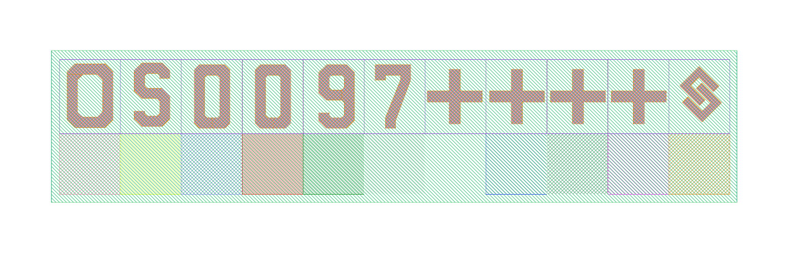 |
| **The monkey:** chip art in metal2 | **The OS0097 Silicon No. block** as placed on the die |

How the core was built, stage by stage (`images/2_layout_steps/`):

| 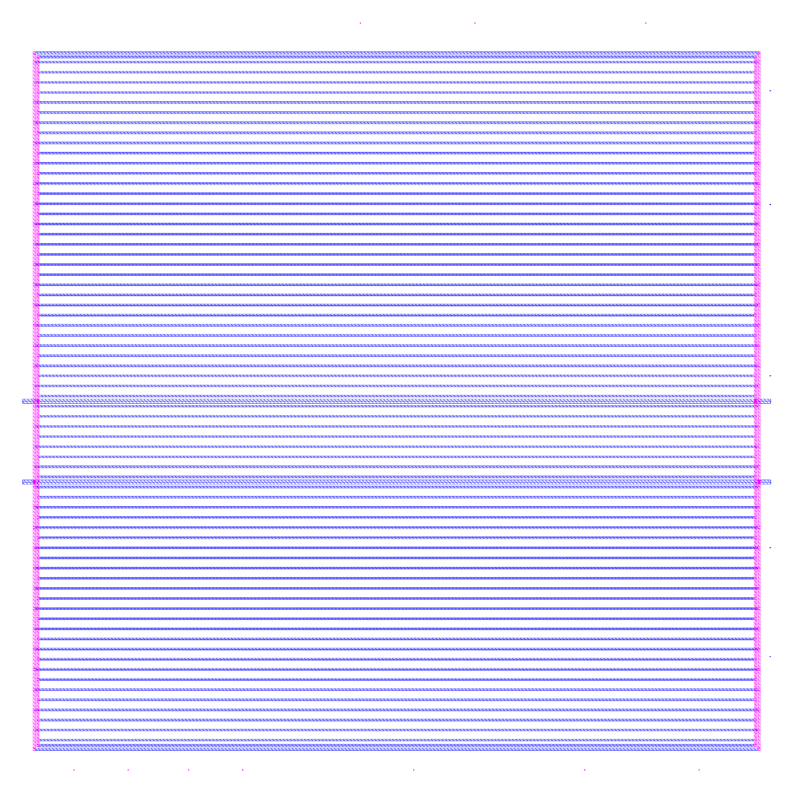 | 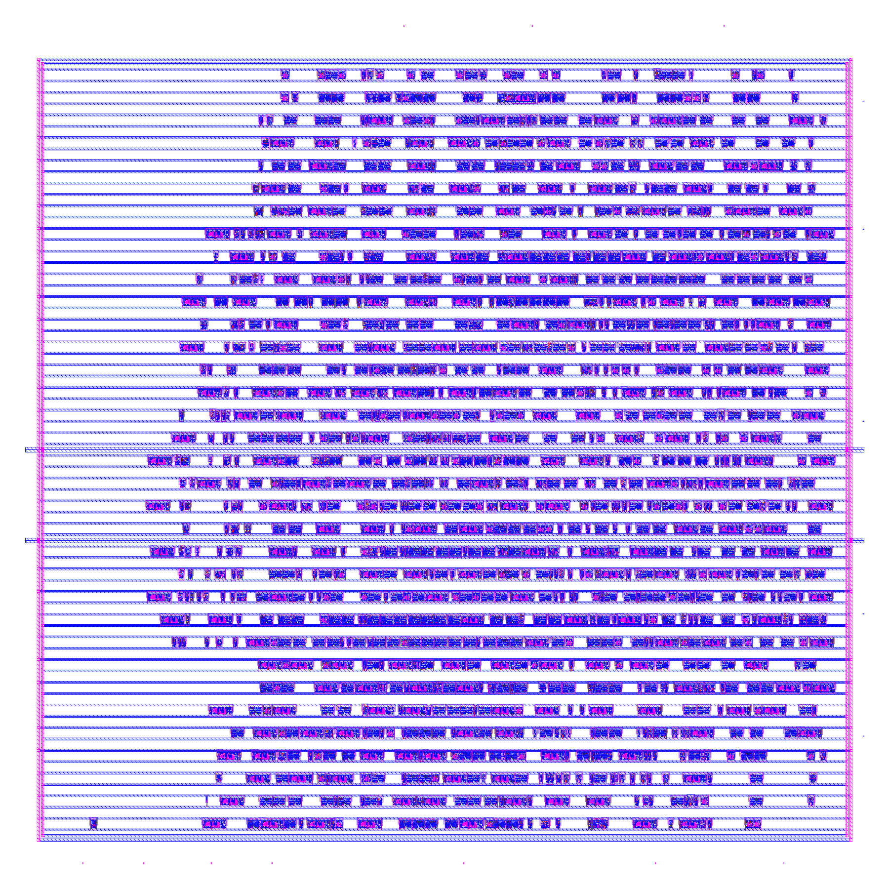 | 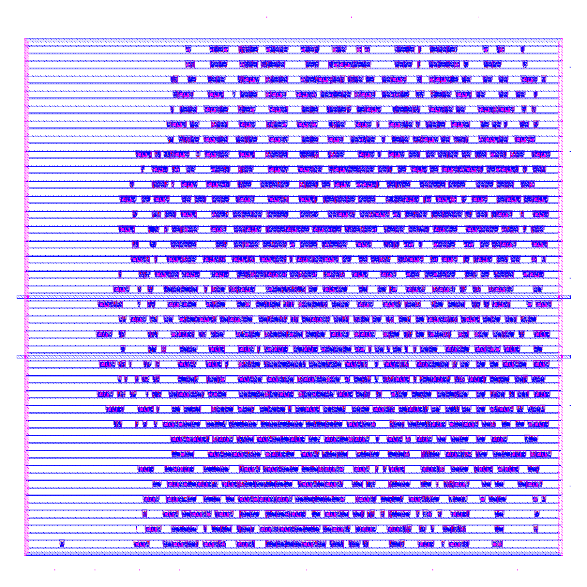 | 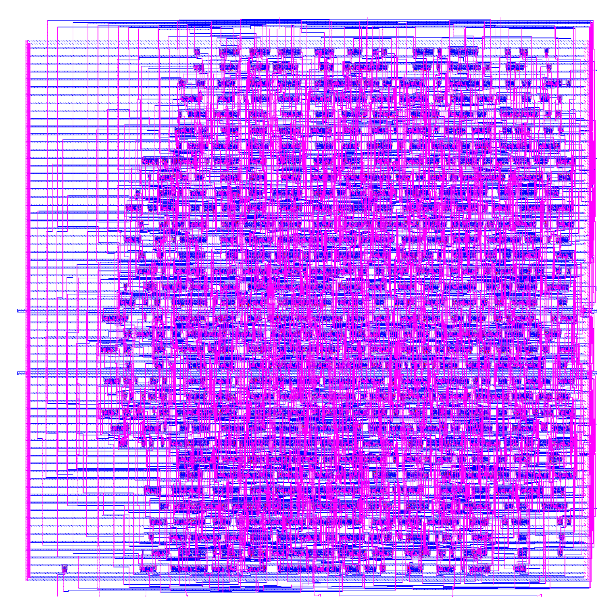 |
|---|---|---|---|
| Floorplan + power | Placement | Clock tree | Routed |

Module hierarchy, RTL-level and gate-level schematics are in `images/3_hierarchy/`, `images/4_rtl/` and
`images/5_gates/` (`.svg` for zooming, `.png` where small enough).

## Layout of this repo

| Folder | Contents |
|---|---|
| `rtl/` | Verilog RTL: `spi_slave.v`, `cdc_sync.v`, `reset_sync.v`, `reg_bank.v`, `pwm_core.v`, `pwm8_spi_top.v` |
| `rtl/chip/` | `pwm8_spi_core.v` (P&R block with output drivers), `pwm8_spi_chip.v` (chip top + pad map) |
| `tb/` | Self-checking testbenches; `tb/models/` holds tie-cell models written for this project |
| `syn/` | Yosys script, SDC, log and synthesised netlist |
| `flow/` | P&R, routing-LEF generation and audit, GDS assembly, DRC/LVS, sign-off and image scripts |
| `pnr/` | DEFs per P&R stage, routed and power netlists, pin placement (`libtest/` = cell-library qualification block) |
| `sta/`, `signoff/` | Pre- and post-route STA at min/typ/max: SDF, SPEF, timing and DRV reports |
| `sim/` | Gate-level and post-layout simulation logs |
| `lvs/` | Design netlists for LVS |
| `checks/` | DRC / LVS logs and DRC marker databases, grid audit, routing-LEF audit |
| `layout/art/` | Chip art (metal-only) |
| `images/` | Chip renders, layout steps, hierarchy, RTL and gate-level schematics |
| `submission/` | DRC report, GDS-rules check, LVS log and MD5 of the submitted GDS |
| `docs/` | Specification, full RTL-to-GDSII flow write-up and flow log |

## Not in this repo

These are SCL's or are not redistributable:

- the SCL C1D PDK and anything copied from it: standard-cell / IO-pad libraries (Liberty, LEF, CDL, Verilog
  models), the pad frame, the DRC/LVS decks, and the routing LEF and timing libraries derived from them
- GDS files that contain SCL cells or the pad frame (core, chip and submission GDS), the OpenROAD databases,
  transistor-level LVS extractions, compiled simulations that bundle SCL's cell models, and the cell-layout
  gallery (`images/6_cells/`)
- the SCL-issued Silicon No. block and requisition, and the submission paperwork

To rebuild, get the PDK from SCL / eChipHub, put it under `~/scl/` as the scripts expect (`flow/env.sh`), and
follow `docs/RTL_TO_GDSII_FLOW.md`.
